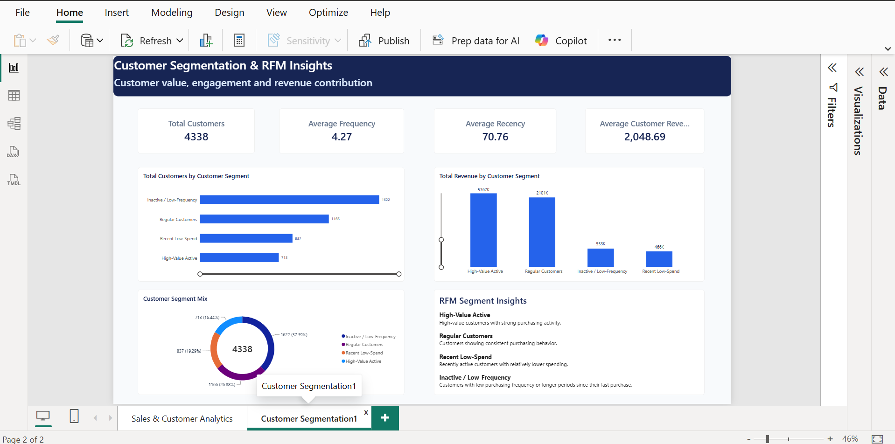

# Intelligent Sales & Customer Analytics Platform

An end-to-end data analytics and machine learning project that transforms retail transaction data into actionable business insights through sales analysis, customer segmentation, inactivity analysis, customer prioritization, churn prediction, a REST API, and Power BI dashboards.

## Project Overview

This project analyzes historical retail purchasing behavior to understand sales performance, segment customers, identify inactive customers, prioritize customer relationships, and estimate the likelihood of future purchasing inactivity.

The solution combines Python, SQL, PostgreSQL, scikit-learn, FastAPI, and Power BI in an integrated analytics workflow.

## Technology Stack

- **Programming:** Python
- **Data Analysis:** Pandas, NumPy
- **Machine Learning:** Scikit-learn
- **Database:** PostgreSQL, SQL
- **Visualization:** Power BI
- **API Development:** FastAPI, Uvicorn
- **Testing:** Pytest
- **Version Control:** Git and GitHub

## Project Features

### 1. Sales Analytics

- Analyze revenue, quantities, invoices, customers, countries, and product performance.
- Explore historical sales trends and customer purchasing behavior.
- Prepare transaction data for downstream analysis.

### 2. Customer Segmentation (RFM)

- Calculate Recency, Frequency, and Monetary value.
- Group customers based on purchasing behavior.
- Summarize segment-level customer and business performance.

### 3. Customer Inactivity Analysis

- Classify customers using a 90-day inactivity threshold.
- Identify customers who may require re-engagement.
- Support retention analysis using historical purchasing behavior.

**Note:** This is retrospective, rule-based inactivity classification. It is distinct from predictive churn modeling.

### 4. Customer Priority Scoring

Calculate a weighted, rule-based customer priority score using the following factors:

| Factor | Weight |
|---|---:|
| Recency | 40% |
| Frequency | 30% |
| Monetary value | 30% |

Customers are categorized as Low, Medium, or High Priority to support business prioritization.

**Note:** These scores are heuristic rankings, not validated predictions of lead conversion.

### 5. Customer Churn Prediction

- Engineer customer-level features from historical transaction data.
- Define a future inactivity label using a separate observation window.
- Train and evaluate Logistic Regression and Random Forest classifiers.
- Compare models using accuracy, precision, recall, F1-score, and ROC-AUC.
- Export evaluation metrics and held-out test-set predictions for downstream analysis.

The current target identifies customers who made no purchase during the label window. It should be interpreted as **future-window purchase inactivity**, not proof of permanent customer churn.

#### Model Evaluation Results

| Metric | Logistic Regression | Random Forest |
|---|---:|---:|
| Accuracy | 0.688 | 0.688 |
| Precision | 0.663 | 0.673 |
| Recall | 0.742 | 0.711 |
| F1-score | 0.700 | 0.691 |
| ROC-AUC | 0.754 | 0.752 |

Logistic Regression achieved higher recall, F1-score, and ROC-AUC in this evaluation. Random Forest achieved slightly higher precision.

Model selection should consider the business cost of missing potentially inactive customers versus contacting customers who might purchase again.

These results are based on a held-out test set and do not guarantee future performance.

### 6. FastAPI REST API

The API exposes sales summaries, customer segments, priority scores, and saved churn prediction results.

| Method | Endpoint | Purpose |
|---|---|---|
| GET | `/` | API welcome information |
| GET | `/health` | Check API and data-file availability |
| GET | `/summary` | Sales and customer summary |
| GET | `/segments` | Customer segment summary |
| GET | `/segments/{customer_id}` | Retrieve one customer's segment details |
| GET | `/priority` | Retrieve the ranked customer priority list |
| GET | `/priority/{customer_id}` | Retrieve one customer's priority details |
| GET | `/churn` | Retrieve saved churn predictions |
| GET | `/churn/{customer_id}` | Retrieve saved churn prediction details for a customer |

The churn endpoint supports selecting a model using the `model` query parameter:

- `logistic`
- `random_forest`

It also supports limiting the number of returned records.

Interactive API documentation is available at `/docs` when the server is running.

**Important:** The current churn API serves saved predictions for customers in the held-out test set. It does not automatically generate live predictions for every customer.

### 7. Power BI Dashboard

The Power BI report presents sales performance and customer analytics visually.

#### Sales & Customer Performance


#### Customer Segmentation & RFM Insights



Open `Intelligent_Sales_Customer_Analytics_Fixed.pbix` in Power BI Desktop to explore the report.

## Project Structure

```text
intelligent-sales-analytics/
├── api/
│   └── main.py
├── data/
│   └── processed/          # Generated locally; see setup instructions
├── notebooks/
├── screenshots/
│   ├── sales-customer-dashboard.png.png
│   └── customer-segmentation-rfm.png.png
├── sql/
├── tests/
│   └── test_api.py
├── analyze_data.py
├── churn_analysis.py
├── churn_business_impact.py
├── churn_prediction_model.py
├── clean_data.py
├── customer_priority_scoring.py
├── customer_segmentation.py
├── explore_data.py
├── load_data.py
├── test_db.py
├── requirements.txt
├── .gitignore
├── Intelligent_Sales_Customer_Analytics_Fixed.pbix
└── README.md
```

The structure above highlights the principal project files. Some folders may contain additional files.

## Setup and Run

### 1. Clone the repository

```powershell
git clone https://github.com/Pranalilahakar/intelligent-sales-customer-analytics.git
cd intelligent-sales-customer-analytics
```

### 2. Create and activate a virtual environment

```powershell
python -m venv .venv
.\.venv\Scripts\Activate.ps1
```

### 3. Install dependencies

```powershell
python -m pip install -r requirements.txt
```

### 4. Prepare the required data

Processed datasets and model output files are generated locally and are not included in the GitHub repository.

Run the relevant data preparation and analysis scripts in the appropriate order to generate the files required by the API, churn model, and Power BI report.

The exact inputs required by each script depend on the project's local data and database configuration.

### 5. Start the API

```powershell
python -m uvicorn api.main:app --reload
```

Open the following URLs in your browser:

- API root: http://127.0.0.1:8000/
- Interactive API documentation: http://127.0.0.1:8000/docs
- Health check: http://127.0.0.1:8000/health

Ensure the required processed data files are available before using endpoints that depend on them.

### 6. Run the tests

```powershell
python -m pytest -v
```

The PostgreSQL connection test may be skipped unless the required database-test configuration and credentials are provided. Configure PostgreSQL locally before running database-dependent functionality.

### 7. Run the churn prediction model

```powershell
python .\churn_prediction_model.py
```

With the required input data and dependencies available, the script trains and evaluates the configured classifiers and generates model metrics and held-out test-set predictions under `data/processed/`.

### 8. Open the Power BI report

Open `Intelligent_Sales_Customer_Analytics_Fixed.pbix` in Power BI Desktop.

If the report requires a local data source or refreshed data, configure the source and refresh the report as appropriate.

## Data and Interpretation Notes

- The project uses historical retail transaction data.
- Feature engineering and churn labels use separate time windows to evaluate future-window purchasing inactivity.
- Churn predictions represent a held-out test set, not necessarily every customer in the source dataset.
- Customer priority scoring is rule-based and distinct from machine-learning churn prediction.
- Processed datasets and model output files are generated locally and are not included in the GitHub repository.
- Run the relevant preprocessing and modeling scripts to generate the files required by the API and dashboard.
- Model performance on historical test data does not guarantee future business outcomes.

## Future Improvements

- Add automated data validation and preprocessing checks.
- Improve model evaluation through cross-validation and additional metrics.
- Build a reproducible workflow for generating and refreshing customer predictions.
- Integrate refreshed model outputs into Power BI.
- Expand API integration and automated testing.
- Document business recommendations and model limitations more comprehensively.

## Author

**Pranali Lahakar**

GitHub: [Pranalilahakar](https://github.com/Pranalilahakar)

Project repository: [Intelligent Sales & Customer Analytics Platform](https://github.com/Pranalilahakar/intelligent-sales-customer-analytics)
