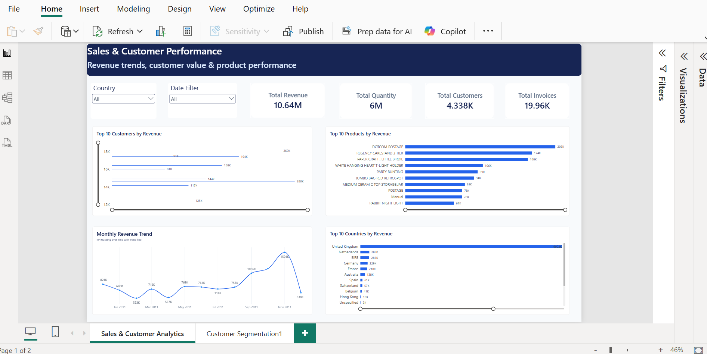
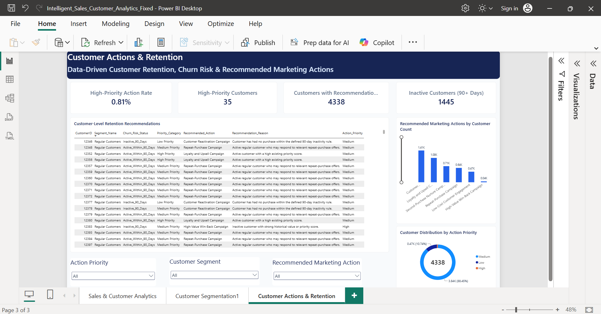

# Intelligent Sales & Customer Analytics Platform

An end-to-end data analytics and machine learning project that transforms retail transaction data into actionable business insights. The platform combines sales analytics, RFM customer segmentation, inactivity analysis, customer prioritization, churn prediction, REST API development, and interactive Power BI dashboards.

## Project Overview

Businesses need to understand sales performance, customer purchasing patterns, and potential retention risks to make better decisions.

This project analyzes historical retail transaction data to:

- Track revenue, sales quantities, invoices, and customer behavior.
- Segment customers using Recency, Frequency, and Monetary (RFM) analysis.
- Identify inactive customers and prioritize customer relationships.
- Estimate future-window purchasing inactivity using machine learning.
- Expose analytical results through REST API endpoints.
- Visualize sales, customer segments, and retention recommendations in Power BI.

## Technology Stack

| Area | Technologies |
|---|---|
| Programming | Python |
| Data analysis | Pandas, NumPy |
| Machine learning | Scikit-learn |
| Database | PostgreSQL, SQL |
| Visualization | Microsoft Power BI |
| API development | FastAPI, Uvicorn |
| Testing | Pytest |
| Version control | Git, GitHub |

## Project Features

### 1. Sales Analytics

- Analyze revenue, quantities sold, invoices, customers, countries, and product performance.
- Explore historical sales trends and customer purchasing behavior.
- Prepare transaction data for downstream analytical workflows.

### 2. Customer Segmentation Using RFM

- Calculate Recency, Frequency, and Monetary value for customers.
- Group customers according to historical purchasing behavior.
- Summarize customer segments and their contribution to business performance.

### 3. Customer Inactivity Analysis

- Classify customers using a 90-day inactivity threshold.
- Identify customers who may benefit from re-engagement campaigns.
- Support retention planning with historical purchasing information.

**Important:** This is retrospective, rule-based inactivity classification. It is distinct from machine-learning churn prediction.

### 4. Customer Priority Scoring

Calculate a rule-based customer priority score using the following weights:

| Factor | Weight |
|---|---:|
| Recency | 40% |
| Frequency | 30% |
| Monetary value | 30% |

Customers are assigned Low, Medium, or High priority to help organize customer engagement efforts.

These scores are heuristic rankings, not validated predictions of lead conversion or future revenue.

### 5. Customer Churn Prediction

- Engineer customer-level features from historical transaction data.
- Define a future purchase-inactivity label using a separate observation window.
- Train and evaluate Logistic Regression and Random Forest classifiers.
- Compare models using accuracy, precision, recall, F1-score, and ROC-AUC.
- Export evaluation metrics and held-out test-set predictions.

#### Model Evaluation Results

| Metric | Logistic Regression | Random Forest |
|---|---:|---:|
| Accuracy | 0.688 | 0.688 |
| Precision | 0.663 | 0.673 |
| Recall | 0.742 | 0.711 |
| F1-score | 0.700 | 0.691 |
| ROC-AUC | 0.754 | 0.752 |

In this evaluation, Logistic Regression achieved higher recall, F1-score, and ROC-AUC, while Random Forest achieved slightly higher precision.

Model selection should account for the business cost of missing potentially inactive customers versus contacting customers who may purchase again.

**Interpretation:** The target represents future-window purchase inactivity. It does not establish that a customer has permanently churned, and historical test results do not guarantee future performance.

### 6. Customer Purchase Propensity

The project includes a customer purchase-propensity modeling workflow and API integration to support analysis of customers' likelihood of purchasing.

The results depend on the implemented model, its features, and the available prediction data. They should be interpreted in the context of the model's training and evaluation design.

### 7. Customer Action Recommendations

The customer action recommendation workflow combines customer purchasing behavior, segment information, inactivity status, and priority scoring to organize potential retention actions.

Example recommendations include:

- Customer Reactivation Campaign
- Loyalty and Upsell Campaign
- Second-Purchase Nurture Campaign
- Repeat-Purchase Campaign
- Low-Cost Customer Engagement
- High-Value Win-Back Campaign

These are rule-based business recommendations intended to support customer engagement planning, not guarantees that a campaign will produce a particular outcome.

### 8. FastAPI REST API

The API exposes sales summaries, customer segments, priority scores, churn predictions, and customer action recommendations.

| Method | Endpoint | Purpose |
|---|---|---|
| GET | `/` | API welcome information |
| GET | `/health` | Check API and data-file availability |
| GET | `/summary` | Sales and customer summary |
| GET | `/segments` | Customer segment summary |
| GET | `/segments/{customer_id}` | Retrieve one customer's segment details |
| GET | `/priority` | Retrieve the customer priority list |
| GET | `/priority/{customer_id}` | Retrieve one customer's priority details |
| GET | `/churn` | Retrieve saved churn predictions |
| GET | `/churn/{customer_id}` | Retrieve a customer's saved churn prediction |
| GET | `/customer-actions` | Retrieve customer action recommendations |

The churn endpoint supports the `model` query parameter for selecting a model:

- `logistic`
- `random_forest`

The endpoint also supports limiting the number of returned records.

Interactive API documentation is available at `/docs` when the server is running.

**Important:** The current churn API serves saved predictions for customers in the held-out test set. It does not automatically generate live predictions for every customer. See the API implementation for the exact supported parameters and response fields.

## Power BI Dashboards

The Power BI report contains three pages that connect business performance analysis with customer retention insights.

### 1. Sales & Customer Performance

Explore overall revenue, quantities sold, customer and invoice counts, product performance, country analysis, and historical sales trends.



### 2. Customer Segmentation & RFM Insights

Explore customer segments, RFM metrics, segment-level customer counts, revenue contribution, and purchasing behavior.


### 3. Customer Actions & Retention

Explore high-priority customers, inactive customers, recommended marketing actions, customer priority distribution, and customer-level retention recommendations.



Open `Intelligent_Sales_Customer_Analytics_Fixed.pbix` in Power BI Desktop to explore the interactive report.

If the report depends on local data files, configure the relevant data sources and refresh the report as needed.

## Project Structure

The repository includes Python analysis and modeling scripts, an API, automated tests, and a Power BI report.

```text
intelligent-sales-analytics/
├── api/
│   └── main.py
├── data/
│   └── processed/                 # Generated locally
├── notebooks/
├── screenshots/
│   ├── sales-customer-dashboard.png
│   ├── customer-segmentation-rfm.png
│   └── customer-actions-retention.png
├── sql/
├── tests/
├── requirements.txt
├── analyze_data.py
├── churn_analysis.py
├── churn_business_impact.py
├── churn_prediction_model.py
├── clean_data.py
├── customer_priority_scoring.py
├── customer_segmentation.py
├── explore_data.py
├── load_data.py
├── test_db.py
├── .gitignore
├── Intelligent_Sales_Customer_Analytics_Fixed.pbix
└── README.md
```

This is a high-level overview; additional files may exist in individual folders. Refer to the repository for the current structure.

## Setup and Installation

### Prerequisites

- Python installed and available on your PATH.
- Git.
- Power BI Desktop for opening the report.
- PostgreSQL and appropriate local configuration if running database-dependent functionality.

### 1. Clone the repository

```powershell
git clone https://github.com/Pranalilahakar/intelligent-sales-customer-analytics.git
cd intelligent-sales-customer-analytics
```

### 2. Create and activate a virtual environment

```powershell
python -m venv .venv
.\.venv\Scripts\Activate.ps1
```

### 3. Install dependencies

```powershell
python -m pip install -r requirements.txt
```

### 4. Prepare the data

Processed datasets and model output files are generated locally and are not included in the repository.

Run the relevant preprocessing, data-loading, and analysis scripts in the order required by their dependencies. Configure any required source datasets and database connection settings before running database-dependent functionality.

Ensure that the processed files required by the API and Power BI report have been generated before using those components.

### 5. Start the API

```powershell
python -m uvicorn api.main:app --reload
```

Open these URLs in your browser:

- API root: http://127.0.0.1:8000/
- Interactive API documentation: http://127.0.0.1:8000/docs
- Health check: http://127.0.0.1:8000/health
- Customer action recommendations: http://127.0.0.1:8000/customer-actions?limit=5

The customer action endpoint returns a limited set of recommendations when the required processed data is available.

### 6. Run the tests

```powershell
python -m pytest .\tests -v
```

The project test suite has passed 26 tests in the development environment. Results in another environment may differ if dependencies, configuration, or input data differ.

Database-dependent tests may require PostgreSQL configuration and credentials.

### 7. Run the churn prediction model

```powershell
python .\churn_prediction_model.py
```

With the required input data and dependencies available, the script trains and evaluates the configured classifiers and generates the corresponding evaluation results and held-out predictions.

### 8. Open the Power BI report

Open `Intelligent_Sales_Customer_Analytics_Fixed.pbix` in Power BI Desktop.

Configure the data source and refresh the report if local datasets or database connections are required.

## Data and Interpretation Notes

- The project analyzes historical retail transaction data.
- Churn-related labels represent purchasing inactivity during a defined future window.
- Churn API results correspond to saved held-out test-set predictions.
- Customer inactivity classification, customer priority scoring, and machine-learning churn prediction are separate analytical concepts.
- Rule-based customer recommendations support planning but do not guarantee campaign success.
- Processed datasets and model output files are generated locally and are not included in the repository.
- Model performance on historical test data does not guarantee future business outcomes.

## Future Improvements

- Automate data validation and preprocessing.
- Expand model evaluation with cross-validation and additional metrics.
- Build a reproducible pipeline for generating and refreshing predictions.
- Integrate refreshed model outputs into Power BI.
- Expand API integration and automated test coverage.
- Evaluate the business impact of customer retention recommendations.

## Author

**Pranali Lahakar**

- GitHub: [Pranalilahakar](https://github.com/Pranalilahakar)
- Project repository: [Intelligent Sales & Customer Analytics Platform](https://github.com/Pranalilahakar/intelligent-sales-customer-analytics)
